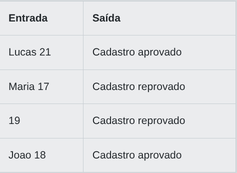

# Desafio 01 - Validação de Cadastro: Nome e Idade em Java

Você trabalha em uma consultoria global de tecnologia responsável por validar regras de negócio em uma grande plataforma digital. Seu time está desenvolvendo um sistema de cadastro de usuários, onde cada novo registro precisa ser avaliado automaticamente para garantir que os dados estejam corretos antes de serem aceitos. Sua tarefa é implementar uma rotina de validação que verifica se o usuário é maior de idade (18 anos ou mais) e se o nome fornecido não está vazio. Apenas usuários que atendam a ambas as condições devem ser aprovados para cadastro. Essa validação é fundamental para garantir a conformidade da plataforma com políticas internas e requisitos legais.

Implemente um programa que receba, em uma única linha, o nome do usuário seguido de um espaço e a idade (um número inteiro). O programa deve analisar os dados e informar se o cadastro foi aprovado ou reprovado, de acordo com as regras descritas. Utilize operadores em sua linguagem para realizar as validações necessárias.

## Entrada

Uma única linha contendo o nome do usuário (string sem espaços) seguido de um espaço e a idade (inteiro). O nome pode ser qualquer sequência de caracteres não vazia, e a idade será um número inteiro entre 0 e 120.


## Saída

Imprima "Cadastro aprovado" se o nome não estiver vazio e a idade for maior ou igual a 18. Caso contrário, imprima "Cadastro reprovado".


## Exemplos

A tabela abaixo apresenta exemplos de entrada e saída:

<p align="center">
  
</p>

## Código Exemplo

```java
java
import java.util.Scanner;

public class Main {
    public static void main(String[] args) {
        Scanner scanner = new Scanner(System.in);
        String entrada = scanner.nextLine();

        // TODO: Divida a entrada em nome e idade, e valide se o nome não está vazio e a idade é maior ou igual a 18.
        // Dica: Use split para separar os dados e operadores lógicos para validar as condições.

        scanner.close();
    }
}
```

## Solução

```java
xxxxxxxxxxxxxxxxxxxxxxxxxxxxxxx
``` 
