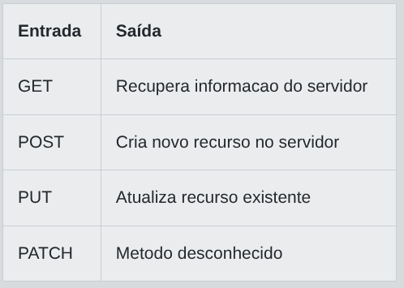

# Desafio 01 - Guia Prático dos Métodos HTTP: Entenda REST com Java

Imagine que você é um(a) jovem desenvolvedor(a) chamado(a) Alex, recém-contratado(a) por uma startup de tecnologia que está criando um sistema de biblioteca digital. Seu mentor, entusiasta de boas práticas, quer garantir que todos na equipe compreendam a semântica dos métodos HTTP essenciais para o estilo arquitetural REST. Para isso, ele propõe um desafio: dado o nome de um método HTTP, você deve retornar a descrição resumida de sua função, ajudando a equipe a memorizar o propósito de cada verbo. Sua missão é criar um programa que, ao receber o nome de um método HTTP (em letras maiúsculas), retorne uma breve explicação sobre seu uso. Caso o método não seja reconhecido, retorne "Metodo desconhecido".

Implemente um programa que leia uma string representando um método HTTP e imprima a descrição correspondente. Considere apenas os métodos GET, POST, PUT e DELETE. Para qualquer outro valor, retorne a mensagem padrão de método desconhecido. Não utilize bibliotecas externas.

## Entrada

Uma única linha contendo uma string em letras maiúsculas representando o método HTTP a ser consultado. Os valores possíveis são GET, POST, PUT, DELETE ou qualquer outra palavra

## Saída

Uma única linha contendo a descrição resumida do método HTTP informado, conforme especificado abaixo, ou a mensagem "Metodo desconhecido" caso o método não seja reconhecido.

## Exemplos

A tabela abaixo apresenta exemplos de entrada e saída:

<p align="center">
  
</p>

## Código Exemplo

```java
java
import java.util.Scanner;

public class Main {
    public static void main(String[] args) {
        Scanner scanner = new Scanner(System.in);
        String metodo = scanner.nextLine().trim();

        // TODO: Imprima a descrição correta do método HTTP informado ou "Metodo desconhecido" se não reconhecido

        // Dica: Use uma estrutura condicional para comparar o valor de 'metodo' com os métodos HTTP conhecidos.
    }
}
```

## Solução

```java
xxxxxxxxxxxxxxxxxxxxxxxxxxxxxxx
``` 
